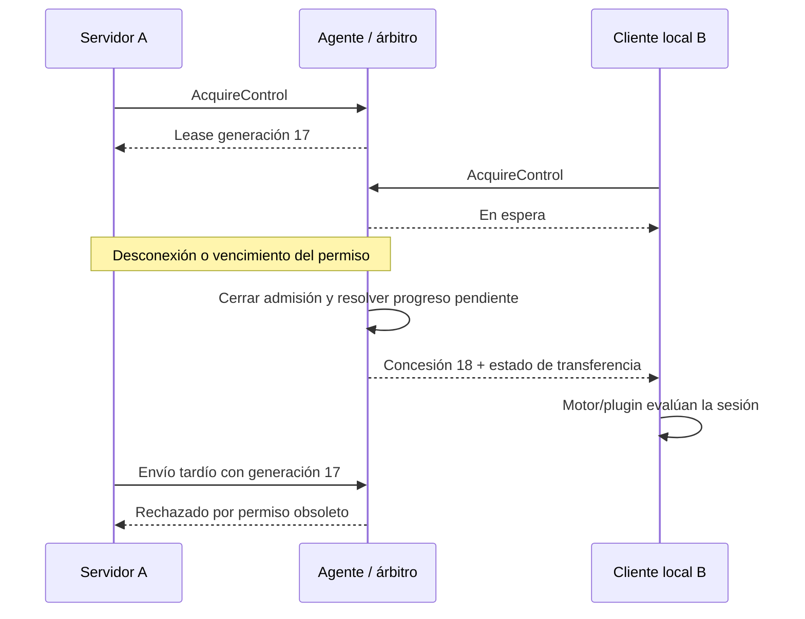

# Contratos entre agente, motor, plugin y ETL

Estado: especificación lógica propuesta. Los nombres son adaptables al EDC; no son APIs ya implementadas. La codificación binaria y sus vectores de interoperabilidad se cierran durante la primera prueba de concepto.

## Identidades y ámbitos

| Campo | Significado |
|---|---|
| `instrumentId` | Identidad estable del instrumento dentro del dominio |
| `agentId` / `portId` | Agente y puerto configurado; no depender sólo de un COM o tty asignado dinámicamente |
| `agentEpoch` | Identificador nuevo en cada arranque del agente; invalida permisos de un arranque anterior |
| `controllerId` | Instancia EDC autorizada; distinta de usuario/paciente y vinculada a su identidad autenticada |
| `connectionId` | Conexión técnica; cambia al reconectar |
| `generation` | Contador creciente de concesiones por puerto dentro de `agentEpoch` |
| `protocolSessionId` | Sesión interpretada por ASTM/plugin; puede relacionar varias conexiones técnicas |
| `operationId` | Operación interpretada por el proceso; puede abarcar múltiples intercambios y sesiones |

Las identidades de mensaje, ejecución y muestra del fabricante se preservan con su significado original. No se reemplazan por un hash o un contador de conexión.

## Canal binario del motor ASTM

`IInstrumentByteChannel` es un contrato técnico que implementan los adaptadores de Infrastructure. Conceptualmente ofrece:

```text
GetCapabilities()                         -> ChannelCapabilities
AcquireControl(request, cancellation)     -> ControlLease
RenewControl(lease, cancellation)         -> ControlLease
ConfirmTransferContext(lease, transferId) -> estado técnico de admisión
ReleaseControl(lease, cancellation)       -> ReleaseOutcome
ReadAsync(buffer, cancellation)           -> ReadOutcome
WriteAsync(bytes, lease, cancellation)    -> WriteOutcome
ReadEventsAsync(cancellation)             -> secuencia de ChannelEvent
GetTrace(range, cancellation)             -> segmentos y eventos disponibles
```

`ReadOutcome` informa cantidad de bytes, origen, offsets y continuidad cuando estén disponibles. El consumidor proporciona el buffer y conserva sus bytes mientras los procesa. Una lectura de longitud cero significa fin de canal según la implementación; un timeout o pérdida se informa sin inventar un mensaje ASTM vacío.

`WriteOutcome` contiene `writeId`, cantidad solicitada, cantidad aceptada y progreso técnico conocido. La cancelación o desconexión puede producir progreso parcial o desconocido: la API lo devuelve explícitamente junto con referencias de traza.

No se declara que escribir al driver implique recepción por el instrumento. La respuesta de éste se observa en el stream y la interpreta el motor/plugin.

## Capacidades negociadas

El agente o adaptador publica, como mínimo:

```text
protocolVersion, platformProfile, agentEpoch
supportedPortSettings, serialSignals
enforcedOwnership, controlLease, queuedAcquisition
traceCapture: None | Ram | Durable
traceCapacityBytes, traceRetention, availableTraceRanges
rxWhenUnowned, hardwareFlowControl, bufferLimits
maxRecordBytes, diagnosticEvents
```

Un perfil ESP32 con memoria RAM no anuncia persistencia durable. Un TCP nativo que no excluye otros clientes no anuncia `enforcedOwnership=true`. Las capacidades se comparan con los requisitos del perfil del instrumento antes de habilitarlo.

## Arbitraje de bajo nivel

El semáforo se implementa como un permiso exclusivo renovable, aplicado por quien puede bloquear las escrituras físicas: el agente, un proxy común o el instrumento si dispone de un mecanismo comprobado.

1. El candidato autentica su identidad y solicita control de un `portId`/instrumento.
2. Si existe propietario, la solicitud entra en la cola hasta su deadline o cancelación.
3. El árbitro concede una generación nueva al siguiente candidato autorizado.
4. Cada escritura se valida contra `(agentEpoch, portId, controllerId, connectionId, generation)`.
5. La renovación usa el reloj monotónico del árbitro. Al vencer, el permiso deja de admitir nuevas escrituras.
6. El cambio de propietario atraviesa una fase de quiescencia y publica un resultado de transferencia.

La cola contiene solicitudes de control. La autorización de una solicitud no almacena una orden ASTM para enviarla automáticamente cuando llegue su turno. El plugin mantiene la intención y evalúa su vigencia al adquirir el canal.

La política propuesta usa prioridad configurada y FIFO para igual prioridad. La prioridad no expulsa por sí sola al propietario activo. La cesión cooperativa y la recuperación por vencimiento son eventos diferentes y quedan registrados.

Los candidatos en espera no consumen el stream destinado al propietario. Si se habilita observación, reciben copias identificadas como diagnóstico, con buffers independientes y sin capacidad de generar respuestas.

## Generaciones, bytes pendientes y cambio de controlador

Una generación nueva rechaza envíos tardíos del propietario anterior. Al reiniciar el agente, cambia `agentEpoch` aunque el contador vuelva a empezar. El token se vincula a la conexión autenticada; no basta con presentar un número recibido en una traza.

El rechazo de escrituras nuevas no retira bytes ya entregados al driver o al instrumento. El árbitro debe cerrar la admisión de la generación anterior y resolver el progreso de sus escrituras antes de habilitar nuevas escrituras:

- Esperar de forma acotada la terminación de lo ya admitido o informar interrupción/progreso incierto.
- Registrar cantidades y rangos conocidos. Un timeout no se transforma en un éxito.
- Publicar `OwnershipTransferred` con `previousGeneration`, `newGeneration`, rangos pendientes y `uncertainTx`.
- Exigir que el nuevo controlador reciba y acepte ese estado antes de habilitar sus envíos.

La concesión incluye un `transferId`; `ConfirmTransferContext` acredita recepción del contexto técnico y abre la admisión para el propietario actual. No acredita recuperación del proceso ni obliga a continuar la conversación previa. El controlador puede habilitar el canal para ejecutar las acciones de recuperación elegidas por su motor/plugin.

Esta fase es técnica: no busca delimitadores, silencios o finales ASTM. El motor y el plugin determinan la acción siguiente con la evidencia disponible. Un reset o purge del puerto es una operación explícita y autorizada, cuyo efecto se registra; no forma parte implícita de cualquier failover.



## Contrato de red agente–ETL

La primera versión implementa un endpoint TCP gestionado por puerto, configurable con TLS, al que se conecta el ETL. Control y datos se distinguen mediante un protocolo de transporte versionado; el adaptador del ETL entrega al motor únicamente el payload serial.

| Mensaje lógico | Contenido principal |
|---|---|
| `Hello` / `Capabilities` | Versiones, identidades autenticadas, capacidades y límites |
| `Acquire` / `Queued` / `Granted` | Instrumento, candidato, requestId, prioridad, deadline y permiso |
| `Renew` / `Release` / `Revoked` | Permiso y motivo; estado técnico de transferencia |
| `TransferState` / `ConfirmTransferContext` | Contexto técnico de cambio, transferId y habilitación de la admisión del propietario actual |
| `SerialData` | Dirección, secuencia, offset, vínculo de propiedad y bytes binarios |
| `WriteStatus` | writeId, progreso conocido y resultado técnico |
| `PortEvent` | Apertura, señales, error, saturación o discontinuidad |
| `TraceRead` / `TraceChunk` | Rangos solicitados/disponibles y modo de diagnóstico |
| `Heartbeat` / `Error` | Salud técnica y fallo correlacionado |

Los contadores de datos son independientes por dirección y arranque/puerto. Las respuestas se correlacionan con `requestId`. Un `SerialData` hacia el instrumento se vincula al permiso actual. Los bytes recibidos sin propietario quedan identificados como no asignados dentro de los límites anunciados; no se mezclan silenciosamente con datos nuevos.

La codificación debe fijar antes de implementar ambos extremos: cabecera y endian, delimitación/longitud, tipos numéricos, máximo de registro, versiones compatibles, errores y vectores de prueba. Los datos de instrumento viajan como bytes, sin conversión a texto o base64 en el recorrido normal. JSON/base64 puede utilizarse para configuración y exportación diagnóstica.

TCP no conserva límites entre escrituras. El parser del contrato gestionado también debe ser incremental y validar tamaños antes de reservar memoria. La agrupación de bytes no esperará una trama ASTM ni un buffer lleno.

El modo TLS o claro se decide por endpoint. Cuando se usa TLS, la autenticación y autorización preceden a `Acquire`. En modo claro debe declararse el mecanismo de autorización disponible; una etiqueta `controllerId` por sí sola no acredita identidad.

## Estados técnicos separados

```text
Puerto:       Closed -> Opening -> Open -> Faulted -> Closed
Conexión:     Connecting -> Authenticating -> Ready -> Disconnected
Propiedad:    Unowned -> Owned -> Quiescing -> Unowned / Owned por otro
Conversación: estados del motor ASTM, independientes de los anteriores
Operación:    estados definidos por el plugin/proceso y Application
```

`Ready` no equivale a propietario, un permiso no equivale a una sesión ASTM establecida y un ACK ASTM no equivale necesariamente a una operación de negocio completada.

## Contrato motor–plugin

| Operación conceptual | Resultado |
|---|---|
| `Describe()` | ID/version del plugin, versiones de motor y perfiles compatibles |
| `CreateProfile(configuration)` | Reglas de framing/conversación y capacidades requeridas |
| `DecodeRecords(message, context)` | Eventos tipados, referencias originales y observaciones del dialecto |
| `BuildMessage(intent, context)` | Mensaje del instrumento y correlación esperada |
| `AssessRecovery(trace, checkpoints, evidence)` | Acciones candidatas, precondiciones y explicación por paso |
| `ExecuteRecovery(approvedPlan, context)` | Acciones técnicas y de negocio permitidas por el proceso |

La herramienta común aloja y presenta el plan; cada plugin/proceso define qué pasos se pueden repetir, consultar, esperar, cancelar o compensar. El contexto incluye versiones y configuración efectiva para que un análisis pueda reproducirse.

## Contrato plugin–Application / ETL

El plugin transforma mensajes a intenciones y hechos tipados, como `OrderQuery`, `OrderPayload`, `InstrumentObservation`, `InstrumentOperationStatus` o `RecoveryEvidence`. Los nombres finales se adaptarán a Application.

Application proporciona consultas de órdenes, configuración vigente, resolución de muestra/analito, recepción de resultados y conciliación. Devuelve estados explícitos con su evidencia: recibido, pendiente de interpretación, aplicado, rechazado o pendiente de decisión, según el caso.

Las referencias de traza y los identificadores del fabricante acompañan las operaciones. La clave y el alcance de la idempotencia se definen por proceso; no se deduplica universalmente por valor, hash del payload o ID de conexión.

Las sesiones en cliente local y servidor deben compartir una identidad lógica de operación cuando estén resolviendo el mismo trabajo y luego conciliar sus efectos. Tener dos controladores autorizados no autoriza aplicar dos veces una misma operación.
