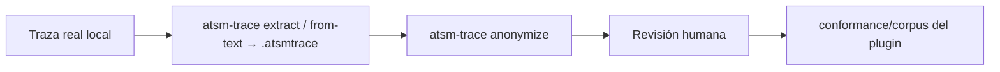

# Datos de prueba, manuales y privacidad

Estado: política propuesta, 24 de octubre de 2026.

## Hallazgo

Las trazas de `trazas_externas/` son capturas reales de producción. Contienen **datos personales y clínicos**: nombres y apellidos, DNI, fechas de nacimiento, sexo, obra social, números de orden y resultados (incluidos serológicos). Se encontraron en los logs de interfaz de Glyms, en `glyms/Pedidos`, `glyms/Resultados` y en los logs de Sysmex. Los archivos de `Importar/` muestran principalmente controles de calidad, pero también llevan identificadores de muestra.

Los manuales de `manuales/` tienen derechos de autor de sus fabricantes; el de Sysmex XN-L está marcado *Classified as Internal*.

**Ninguno de los dos se publica en el repositorio ATSM.** Ambas carpetas están excluidas en `.gitignore` y se tratan como material local de referencia.

## Inventario local

| Carpeta | Archivos | Origen | Uso |
|---|---|---|---|
| `trazas_externas/glyms/Logs/*.log` | 3 | Host Glyms: C4000, CELL-DYN Ruby, I1000 | Conversación LIS01 con controles, reintentos y errores (`Parsing Error`, cola borrada por reintentos) |
| `trazas_externas/glyms/Logs/Importar/` | 151 + 129 NDF + 30 transformados + 2 logs | Exportación por archivo de ARCHITECT i1000SR | Mensajes LIS02 completos; validan `FileDrop` y el plugin Architect |
| `trazas_externas/glyms/Pedidos/`, `Resultados/` | 6 + 6 | Intercambio por archivo con formato propio (`H|DeltaLab…`, `H|glyms…`) | Candidato a plugin de archivo; a confirmar |
| `trazas_externas/Sysmex/` | 8 | Sysmex OnlineInterface/U-WAM: UF-5000, UC-3500, AMS | Host query (`Q`), respuesta con `P/C/O`, resultados de orina |
| `manuales/` | 11 | Fabricantes | Ver [ESTANDARES § Evidencia](ESTANDARES.md) |

## Flujo hacia el corpus publicable

Las trazas se obtienen con `atsm-trace extract <adaptador>` (log de un fabricante o sistema), `from-text` o `from-binary`. `atsm-trace anonymize` trabaja **con el codec**, no con expresiones regulares sobre texto, para saber qué campo es qué:

- Reemplaza campos de paciente (P: id, nombres, nacimiento, sexo, dirección, médico) por valores sintéticos consistentes dentro de la traza.
- Seudonimiza identificadores de muestra/orden con un mapa estable por corpus (misma muestra → mismo seudónimo), de modo que la correlación O ↔ R se conserve.
- Desplaza fechas con un offset constante por corpus, preservando intervalos.
- Conserva códigos de test, unidades, flags, estados, números de serie de lote/reactivo y la estructura byte a byte (longitud de frames recalculada y **checksums recalculados**, documentado en la cabecera de la traza).
- Emite un informe de qué se reemplazó y falla si queda algún campo de paciente sin tratar.

Valores de resultado: se conservan en controles y calibradores; en muestras de paciente se pueden mantener (sin identidad no son atribuibles) salvo decisión contraria del responsable de datos.

El mapa de seudónimos nunca se guarda en el repositorio.

## Reglas

1. Toda traza nueva entra por `trazas_externas/` (ignorada) y sólo pasa al corpus tras anonimizar y revisar.
2. Los ejemplos de documentación son sintéticos.
3. Los manuales se citan por fabricante, título, número de documento y revisión.
4. Si alguna vez se publicó una traza real por error, no basta con borrarla en un commit nuevo: hay que reescribir el historial y avisar al responsable de datos.
