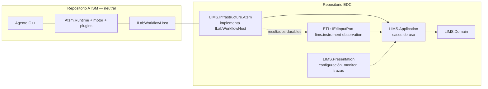

# Integración con EDC

Estado: propuesta. ATSM se publica en su propio repositorio y no referencia EDC. Este documento describe cómo EDC lo consume; el trabajo correspondiente vive en el repositorio EDC y sigue sus reglas (Issue previo, changelog, commits trazables, aprobación de dependencias).

## Frontera

ATSM entrega hechos canónicos; EDC decide qué es una determinación, cuándo se valida y qué se publica.

## Encaje en las cuatro capas

| Capa EDC | Contenido | Depende de ATSM |
|---|---|---|
| `LIMS.Domain` | Muestras, órdenes, determinaciones, equivalencias, políticas de resultado | No |
| `LIMS.Application` | `RecibirObservacionesInstrumento`, `ResponderConsultaOrdenes`, `ObtenerOrdenesPendientes`, `ConciliarOperacion`; puertos propios | No |
| `LIMS.Infrastructure.Atsm` | Adaptador `ILabWorkflowHost` → casos de uso; mapeo de modelo canónico a contratos de Application; alojamiento del `Atsm.Runtime` | **Sí**, único proyecto |
| `LIMS.Presentation` | Configuración de instrumentos/agentes, monitor, visor de trazas, revisión de excepciones | Sólo a través de Application |

Domain y Application no ven tipos `Atsm.*`. Si mañana se reemplaza ATSM, sólo cambia el adaptador.

## Uso de las capacidades del ecosistema EDC

Evaluación exigida por [creación de módulos](../../../Documentacion/Arquitectura/EDC/creacion-modulos.md) (ruta relativa al checkout de EDC):

| Capacidad EDC | Aplicación al LIMS/ATSM | Estado |
|---|---|---|
| ETL `kalyx.etl.io` | Resultados del instrumento como `EtlEvent` durable e idempotente (EventId = `ObservationId`, conservado durante reintentos) hacia un `IEtlInputPort` del LIMS; reintentos y pendientes sin sesión | Propuesto |
| Puerto tipado (sin ETL) | Host query: respuesta sincrónica dentro del plazo LIS01-A2; un journal asíncrono no lo cumple | Propuesto |
| Identidades / CEAC | `controllerId` = instancia EDC autenticada; certificados mTLS por tenant; permisos de operar instrumento, ver trazas (contienen datos clínicos) y ejecutar recuperación | Propuesto |
| Instancias de tenant (#111) | Cada tenant tiene sus instrumentos, agentes autorizados, outbox y almacén de trazas en su carpeta | Propuesto |
| Sync / operación remota | Cliente local como controlador alternativo; conciliación al volver al servidor | Pendiente de diseño (R03) |
| Scheduler / ETL | Watcher de Scheduler y conector LIMS/ETL con custodia/hash/idempotencia; entrega mensajes completos a ATSM. Reenvío de outbox y retención del propietario | Frontera adoptada; conector EDC pendiente |
| Persistencia / EF Migrations | SQLCipher estándar del propietario para originales de comunicación e índice/consulta, hospedado por Application antes de conectar; configuración, mapeos y outbox del LIMS | Requisito adoptado; adaptador/migraciones/UI EDC pendientes |
| Lang | Los códigos estables `ATSM-*` se traducen en Presentation con seed propio | Propuesto |
| DataViews / CRUDPage | Configuración de instrumentos, equivalencias y monitor | Propuesto |
| Console / IA | Consulta de estado de instrumentos y trazas como herramientas, con permisos | Evaluar |
| Firma de ensamblados (#119) | ATSM utiliza la SNK de la distribución, ya implementada; admisión de paquetes por EDC conforme a su baseline | Firma comprobada; adopción/admisión EDC pendiente |

## Dependencia y distribución

- EDC consume ATSM como **paquetes NuGet versionados** publicados desde el repositorio ATSM (feed propio o archivos locales), no como referencia de proyecto fuera de la solución.
- Según `Documentacion/agente.md` §7, incorporarlos requiere aprobación humana registrada en el Issue con origen, versión, licencia, consumidores y transitivas. Mbed TLS sólo afecta al agente nativo, que EDC distribuye como binario aparte.
- El agente C++ se distribuye por plataforma (Windows x86 para XP, Windows x64, Linux x64/ARM, firmware ESP32) con su propio versionado.

## Correspondencia con el sistema legacy

| Sistema legacy | Destino |
|---|---|
| Host de interfaces legacy (host, serial/TCP, carga de plugins) | `Atsm.Runtime` + agente |
| `Plugin.dll` `IPlugin` | `IInstrumentPlugin` / `IDialect` |
| `Plugin_Architect`, `Plugin_Celldyn_Ruby` | `Atsm.Plugin.Abbott.*` |
| `RS232.dll` | Agente nativo / `LocalSerial` |
| `Inter_Equival`, `lims.interface_analito`, `lims.interface_regla` | `CodeMappingSet` (mapeo) + `LIMS.Domain` (reglas) |
| `lims._resultado_insert` y triggers | `LIMS.Application` / `LIMS.Domain` |
| `lims.interface_robot` | Configuración de instrumento en EDC |

## Primer incremento en EDC

1. Issue de decisión: adoptar ATSM como biblioteca externa, aprobar paquetes y alcance.
2. Especificación funcional mínima del módulo LIMS (recepción de resultados y host query).
3. `LIMS.Infrastructure.Atsm` con `ILabWorkflowHost` contra un Application con almacenamiento simple.
4. Prueba de punta a punta con el canal `Replay` y el corpus anonimizado de Architect.

Ningún paso usa equipos productivos.

## Custodia adoptada el 2026-10-24

Application prepara el almacén SQLCipher del tenant e implementa `ITraceSink.EnsureReady`/`Write` antes de crear conexiones; `InstrumentCommunicationHost` ofrece esa frontera antes de la fábrica de canal. La UI futura consulta evidencia/rangos/versiones por puertos autorizados de Application; reproducción diagnóstica no abre equipo ni aplica resultados. No se permite un volcado plano alternativo de datos sensibles. Los archivos de cliente y su retención pertenecen al conector, no a ATSM. No se creó todavía el módulo LIMS, su almacén SQLCipher ni su UI. Ver [decisión, análisis de buffer y límites](MENSAJES-TRAZAS-HL7.md).
