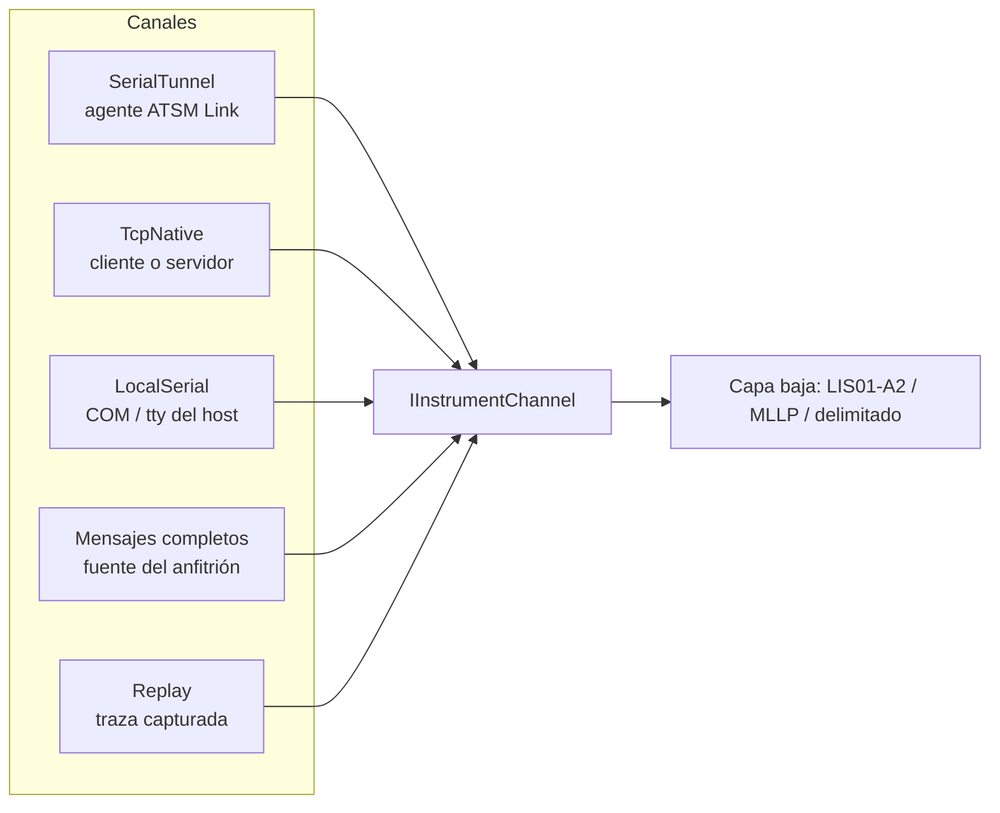

# Interfaz de comunicación

> **Actualización 2026-10-26:** el contrato `IInstrumentChannel` y `Atsm.Channels` se retiraron. ATSM recibe el transporte final como un `Stream` abierto por el anfitrión; los plugins declaran `TransportKnowledge`; `Atsm.Transport` y `PortGate.Client` son opcionales. Ver [TRANSPORTE](TRANSPORTE.md). Lo que sigue se conserva como antecedente de diseño.

Estado: propuesta. Concreta la capa de transporte descrita en [ARQUITECTURA](ARQUITECTURA.md) y la semántica de arbitraje de [CONTRATOS](CONTRATOS.md). Aquí se fija **qué canales existen, cómo se ve el canal desde el motor y cómo viaja todo por la red**.

## Objetivo

El motor genérico recibe siempre el mismo objeto: un flujo binario ordenado en ambas direcciones, con eventos y capacidades declaradas. No sabe si detrás hay un COM local, un agente remoto, un socket del instrumento o una carpeta de archivos.



## Tipos de canal

| Canal | Cuándo | Exclusión | Traza binaria | Notas |
|---|---|---|---|---|
| `SerialTunnel` | Equipo RS232 lejos del host | Fuerte (la aplica el agente) | Agente + host | Canal principal; TLS por endpoint |
| `TcpNative` | Equipo con Ethernet | Sólo si el equipo o un proxy común la aplican | Host | Rol cliente o servidor según el manual; TLS si el equipo lo soporta |
| `LocalSerial` | Host junto al equipo (cliente local, desarrollo) | Del sistema operativo | Host | Mismo motor sin agente; útil para pruebas de banco |
| Mensajes completos | Bytes/Stream o canal suministrado por el anfitrión | Del anfitrión | `ITraceSink` hospedado por la aplicación | `AstmMessageProcessor` / `WholeMessageInstrumentSession`; sin LIS01 ni gestión de archivos |
| `Replay` | Diagnóstico, pruebas, conformidad | No aplica | Es la traza | Nunca abre un puerto físico ni produce efectos externos |

La decisión humana del 2026-10-24 retira el FileDrop propio: EDC usa Scheduler + conector LIMS/ETL y suministra mensajes al motor. Los intercambios con otros laboratorios pertenecen a ese conector. El valor enum `FileDrop` se conserva sólo como reserva de compatibilidad, no como canal implementado.

## Contrato del canal en .NET

```csharp
namespace Atsm.Abstractions.Channels;

public interface IInstrumentChannel : IAsyncDisposable
{
    ChannelDescriptor Descriptor { get; }          // id, tipo, endpoint lógico
    ChannelCapabilities Capabilities { get; }      // ver CONTRATOS § Capacidades

    ValueTask<ControlLease> AcquireAsync(ControlRequest request, CancellationToken ct);
    ValueTask<ControlLease> RenewAsync(ControlLease lease, CancellationToken ct);
    ValueTask<TransferAdmission> ConfirmTransferAsync(ControlLease lease, Guid transferId, CancellationToken ct);
    ValueTask<ReleaseOutcome> ReleaseAsync(ControlLease lease, CancellationToken ct);

    ValueTask<ReadOutcome> ReadAsync(Memory<byte> buffer, CancellationToken ct);
    ValueTask<WriteOutcome> WriteAsync(ReadOnlyMemory<byte> bytes, ControlLease lease, CancellationToken ct);

    IAsyncEnumerable<ChannelEvent> EventsAsync(CancellationToken ct);
}
```

- Es la forma concreta de `IInstrumentByteChannel` de CONTRATOS; se renombra a `IInstrumentChannel` porque el anfitrión puede entregar mensajes completos (`ReadOutcome.IsMessageBoundary = true`).
- Usa `Memory<byte>`/`ValueTask` para no asignar por lectura.
- Un canal sin exclusión real devuelve un `ControlLease` con `Enforcement = Advisory`; el motor puede negarse a operar si el perfil exige `Enforced`.

## PortGate Link v1: protocolo agente ↔ host

### Requisitos

- Implementable en C++17 sin dependencias (Windows XP con `v141_xp`) y en ESP-IDF con poca RAM.
- Bytes del instrumento sin transformar (sin base64, sin texto).
- Parser incremental con tamaño validado **antes** de reservar memoria.
- Versionado negociado y extensible sin romper versiones anteriores.

### Encuadre

Cada unidad viaja sobre TCP (o TLS) con una cabecera fija de 12 bytes, big-endian:

```text
offset  tamaño  campo
0       2       magic        0x41 0x4C  ("AL")
2       1       version      0x01
3       1       type         ver tabla
4       2       flags        bit0 = payload CBOR, bit1 = último fragmento, bit15 = crítico, resto reservado = 0
6       2       channel      índice de puerto dentro del agente (0 = control del agente)
8       4       length       longitud del payload, ≤ maxUnitBytes negociado
12      length  payload
```

- `SerialData` lleva en el payload `seq:u64 | offset:u64 | generation:u32 | bytes…` (cabecera binaria de 20 bytes, luego bytes crudos).
- El resto de los tipos llevan un mapa CBOR con claves enteras (definidas en `spec/link-v1.cddl`) y codificación determinista.
- Un tipo desconocido con `flags.bit15 = 0` se ignora y se registra; con `bit15 = 1` (crítico) cierra la conexión con `Error`. Así se agregan mensajes sin romper agentes viejos.

### Tipos

| type | Mensaje | Dirección | Contenido |
|---|---|---|---|
| 0x01 | `Hello` | ambos | versiones soportadas, `agentId`, `agentEpoch`, perfil de plataforma |
| 0x02 | `Capabilities` | agente → host | por puerto, ver CONTRATOS § Capacidades negociadas |
| 0x10 | `Acquire` | host → agente | `requestId`, `portId`, prioridad, deadline |
| 0x11 | `Queued` / 0x12 `Granted` / 0x13 `Denied` | agente → host | lease, `generation`, `transferId` |
| 0x14 | `Renew` / 0x15 `Release` / 0x16 `Revoked` | ambos | lease y motivo |
| 0x17 | `TransferState` / 0x18 `ConfirmTransfer` | ambos | rangos pendientes, `uncertainTx` |
| 0x20 | `SerialData` | ambos | ver arriba |
| 0x21 | `WriteStatus` | agente → host | `writeId`, aceptados, escritos al driver, resultado |
| 0x22 | `PortEvent` | agente → host | apertura, señales DSR/CTS/DCD, error de paridad/framing, overrun, discontinuidad |
| 0x23 | `PortControl` | host → agente | RTS/DTR, break, purge (requiere lease y permiso explícito) |
| 0x30 | `TraceRead` / 0x31 `TraceChunk` | ambos | rango solicitado/entregado y huecos |
| 0x7E | `Heartbeat` | ambos | marca monotónica, carga de buffers |
| 0x7F | `Error` | ambos | código estable, `requestId` relacionado |

El esquema CDDL (RFC 8610) de cada mapa CBOR será el contrato normativo; los vectores binarios de prueba viven en `conformance/link-v1/` y los usan ambos extremos.

### Seguridad

- TLS 1.3 preferido, 1.2 mínimo; un endpoint `Tls` nunca degrada a claro.
- mTLS recomendado: el certificado del host identifica al `controllerId`; el agente autoriza por puerto con una lista de identidades (huella de clave pública o SAN).
- Modo `Plain` sólo con declaración explícita en la configuración y advertencia en `Hello`; adecuado para laboratorio de banco o redes aisladas.
- Biblioteca TLS: **Mbed TLS 4.1 LTS** (4.1.1), aprobada el 24 de octubre de 2026; ver [DEPENDENCIAS](DEPENDENCIAS.md). En XP el agente aporta su fuente de entropía; ESP32 usará la de ESP-IDF. Con mTLS, el `controllerId` debe coincidir con el CN del certificado o con su huella SHA-256 configurada.

## Agente nativo

```text
PortGate/
  core/          bucle de eventos, Link v1, arbitraje, buffers, traza (C++17, sin excepciones en la ruta de datos)
  platform/win32 Win32 serial (overlapped I/O), Winsock, servicio de Windows
  platform/posix termios, epoll/poll, systemd
  platform/esp32 UART, lwIP, NVS, tarea FreeRTOS
  tls/           adaptador Mbed TLS
  tools/         portgatectl (diagnóstico local)
```

- Un proceso, varios puertos. Cada puerto tiene su máquina de estados Puerto/Propiedad de CONTRATOS.
- Lectura serial con entrega inmediata de lo disponible (sin esperar trama); latencia acotada por `forwardDelayMs` configurable (0 por defecto).
- Captura remota RAM/durable: propuesta pendiente. El agente v1 anuncia `traceCapture = 0`; cualquier persistencia sensible exige cifrado y custodia del anfitrión, no sólo hash encadenado.
- Configuración CBOR instalada por el servidor ([spec/admin-v1.md](../spec/admin-v1.md)); el agente rechaza claves desconocidas y conserva sólo la configuración vigente.
- Sin intérprete ASTM: el agente no conoce ENQ ni ACK.

## Canal en el host (.NET)

```text
dotnet/src/Atsm.Channels/
  SerialTunnel/   cliente Link v1 (System.IO.Pipelines), TLS con SslStream
  TcpNative/      cliente/servidor TCP, TLS opcional
  LocalSerial/    System.IO.Ports
  # Sin FileDrop: el anfitrión entrega contenido y posee los archivos
  Replay/         lectura de traza ATSM
```

`System.IO.Ports` y `System.IO.Pipelines` son paquetes oficiales de Microsoft.

## Formato de traza

Una traza ATSM es independiente del canal y del fabricante:

- Archivo `*.atsmtrace` (v1, `atsm-trace/1`): JSON Lines; la primera línea es la cabecera (origen, instrumento, perfil, limitaciones) y cada línea siguiente un registro `{seq, ms, utc, dir, data(base64), code, detail}`. Es intercambio explícito, no persistencia operativa EDC: Application hospeda SQLCipher antes de conectar; no hay fallback plano. Ver [custodia y buffer](MENSAJES-TRAZAS-HL7.md).
- `atsm-trace dump` muestra una traza con los caracteres de control visibles para revisión humana.
- Los logs externos se convierten en segmentos puros mediante **adaptadores de log que aportan los plugins** de cada serie de equipos; ATSM genérico reconstruye con ellos la traza real y la teórica ([TRAZAS-Y-RECUPERACION § Reconstrucción](TRAZAS-Y-RECUPERACION.md#reconstrucción-de-trazas-reales-y-teóricas)). Cada adaptador declara qué se pierde.

## Cuestiones abiertas

- Rol de conexión invertido (agente sale hacia el host) para sitios sin puertos entrantes.
- Exclusión fuerte para `TcpNative` sin proxy: depende de cada equipo.
- Persistencia de traza en ESP32 (RAM sola o tarjeta SD).
