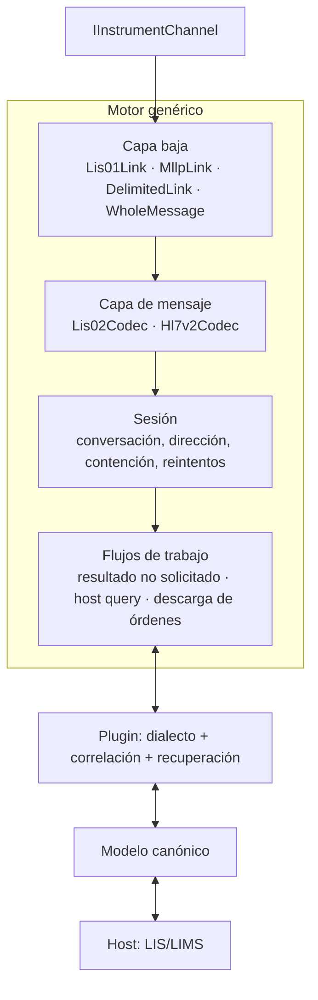

# Motor ASTM genérico

> **Actualización 2026-10-26:** el contrato `IInstrumentChannel` y `Astm.Channels` se retiraron. ASTM recibe el transporte final como un `Stream` abierto por el anfitrión; los plugins declaran `TransportKnowledge`; `Astm.Transport` y `PortGate.Client` son opcionales. Ver [TRANSPORTE](TRANSPORTE.md). Lo que sigue se conserva como antecedente de diseño.

Estado: propuesta. El motor implementa los estándares de [ESTANDARES](ESTANDARES.md) como capas independientes y deja al plugin sólo lo que es propio del instrumento.

## Capas



Cada capa es reemplazable y se prueba sola. Una pieza sólo conoce la capa inmediatamente inferior.

### 1. Capa baja

| Implementación | Estándar | Responsabilidad |
|---|---|---|
| `Lis01Link` | CLSI LIS01-A2 / E1381 | Establecimiento (ENQ/ACK/NAK), frames con número 0–7 y checksum módulo 256 en hex, ETB/ETX, máximo de 247 caracteres por frame, terminación (EOT), contención (el instrumento tiene prioridad), timers de establecimiento, ACK de frame y receptor, reintentos por frame, NAK de ocupado |
| `MllpLink` | HL7 MLLP | `VT … FS CR`, un mensaje por bloque |
| `DelimitedLink` | — | Mensajes delimitados por bytes configurables, para dialectos sin capa baja estándar |
| `WholeMessageInstrumentSession` | — | Límites de mensajes aportados por el anfitrión; `AstmMessageProcessor` también recibe bytes/Stream directamente |

`Lis01Link` es una máquina de estados pura alimentada por eventos (`BytesReceived`, `TimerElapsed`, `SendRequested`) que produce acciones (`Write`, `StartTimer`, `MessageReceived`, `Fault`). No tiene hilos ni E/S: se prueba de forma determinista con un reloj virtual.

Valores por defecto según LIS01-A2. El perfil puede declarar desviaciones documentadas en el manual (por ejemplo, frames mayores, `CR LF` tras el checksum, tolerancia a checksum en minúsculas), cada una con su referencia.

### 2. Capa de mensaje

**`Lis02Codec`** (LIS02-A2 / E1394):

- Lee los delimitadores declarados en el registro H (campo, repetición, componente, escape); nunca los asume.
- Produce un árbol `Message → Record → Field → Repeat → Component`, con acceso por posición **1-based como en la norma** y conservando el texto original de cada campo.
- Jerarquía validada H → P → O → R → C, con Q, M, S y L; registros desconocidos o tipo `M` (fabricante) se preservan íntegros para el plugin.
- Secuencias de escape (`&F&`, `&S&`, `&R&`, `&E&`) decodificadas sólo bajo demanda.
- Encoding de caracteres por perfil (ASCII, Latin-1, UTF-8) declarado, no adivinado.
- Serialización inversa con los mismos delimitadores para construir mensajes salientes.

**`Hl7Codec`** (HL7 v2.x, primer corte implementado): MSH con caracteres de codificación, segmentos, campos/componentes/subcomponentes, escape, ACK original y mejorado. El soporte LAW (OUL^R22, OML^O33, QBP^Q11/RSP^K11) se implementa como flujos de trabajo encima del codec, no dentro de él.

Ambos codecs ofrecen una vista posicional sin modelo y un validador por perfil que informa problemas como datos (no excepciones) para que el plugin decida.

### 3. Sesión

La sesión gobierna la conversación lógica sobre la capa baja:

- Dirección actual (instrumento→host, host→instrumento) y cola de envíos salientes.
- Reglas de contención y reintento del estándar, con límites del perfil.
- Interrupción por el receptor (EOT durante transferencia) y su manejo.
- Correlación de mensajes con `protocolSessionId` y referencias a rangos de traza.
- Estados independientes de los de canal/propiedad ([CONTRATOS § Estados técnicos](CONTRATOS.md)).

### 4. Flujos de trabajo genéricos

| Flujo | Disparador | Qué aporta el motor | Qué aporta el plugin |
|---|---|---|---|
| Resultado no solicitado | Instrumento envía H…P…O…R…L | Recepción, ensamblado, entrega al plugin, confirmación de baja capa | Interpretación de registros a observaciones canónicas |
| Host query | Instrumento envía Q | Plazo de respuesta según timers del perfil, construcción de la respuesta | Traducción de la consulta, armado de órdenes o "sin información" |
| Descarga de órdenes (broadcast) | Host tiene órdenes nuevas | Cola, envío, reintentos de baja capa | Construcción de O/OML y política de reenvío |
| Cancelación / repetición | Host o instrumento | Transporte del mensaje | Si el equipo lo soporta y cómo |
| Estado del instrumento | Registros M o mensajes de estado | Transporte | Interpretación |

**El plazo del host query es el punto crítico de diseño.** Con LIS01-A2 el instrumento espera la respuesta un tiempo limitado; el motor llama al host con un `CancellationToken` con ese presupuesto y, si vence, responde según la política del perfil (sin información / no responder) y lo registra. Por eso la consulta de órdenes al host es **sincrónica y tipada**, nunca a través de una cola asíncrona.

## Perfiles

Un perfil es un documento declarativo, versionado y validado por JSON Schema:

```json
{
  "profile": "abbott.architect.asi-rs232",
  "version": "1.0.0",
  "standards": { "link": "LIS01-A2", "message": "LIS02-A2", "declaredInHeader": "E1394-91" },
  "link": { "maxFrameChars": 247, "timers": { "establishmentMs": 15000, "frameAckMs": 15000, "receiverMs": 30000 },
            "retries": { "frame": 6 }, "deviations": [] },
  "message": { "encoding": "latin1", "recordTerminator": "CR" },
  "requires": { "ownership": "Enforced", "traceCapture": "Ram" },
  "workflows": ["UnsolicitedResults", "HostQuery", "OrderDownload"],
  "evidence": [ { "doc": "Abbott 91407-108", "section": "…" } ]
}
```

- Toda desviación lleva su referencia de evidencia (manual o traza).
- El motor compara `requires` con las capacidades del canal antes de habilitar el instrumento.

## Recuperación

El motor informa evidencia (estado de capa baja, último frame confirmado, progreso de escritura, huecos de traza). La decisión de qué hacer con una operación de negocio pertenece al plugin y al host, según [TRAZAS-Y-RECUPERACION](TRAZAS-Y-RECUPERACION.md). El motor sí resuelve por su cuenta lo que el estándar define: reintentos de frame, timeout de establecimiento, terminación.

## Paquetes

```text
dotnet/src/
  Astm.Abstractions     canal, eventos, capacidades, modelo canónico, contratos de plugin y host
  Astm.Protocol.Lis01   capa baja LIS01-A2
  Astm.Protocol.Lis02   codec LIS02-A2
  Astm.Protocol.Mllp    capa baja MLLP
  Astm.Protocol.Hl7v2   codec HL7 v2 y flujos LAW
  Astm.Runtime          host de instrumentos: carga de plugins, sesiones, perfiles, traza, métricas
  Astm.Testing          reloj virtual, canal simulado, simulador de instrumento, runner de conformidad
```

- `net10.0` (LTS). Sin dependencias fuera de la BCL y paquetes oficiales de Microsoft en el núcleo.
- `Nullable` y analizadores habilitados; API pública con revisión de compatibilidad (`PublicAPI.Shipped.txt`).
- Ensamblados firmados con Strong Name del proyecto ASTM, para que hosts que exigen firma (como EDC) puedan cargarlos.
- Mensajes de diagnóstico como **códigos estables** (`ASTM-L01-TIMEOUT-ESTABLISH`) con texto invariante; la traducción la hace el host.

## Criterios de aceptación del motor

Además de T01–T10 y A01–A02 de [IMPLEMENTACION](IMPLEMENTACION.md):

| ID | Caso | Esperado |
|---|---|---|
| E01 | Mensaje de 5 KB partido en frames intermedios ETB | Reensamblado exacto; frames numerados 1..7,0,1… |
| E02 | Checksum erróneo en un frame | NAK, reintento, y tras el límite, terminación con evento |
| E03 | Contención ENQ simultáneo | El host cede según el estándar y reintenta tras la espera |
| E04 | Delimitadores no estándar en H | Parseo correcto; serialización inversa idéntica |
| E05 | Registro M desconocido | Preservado y entregado al plugin |
| E06 | Host query con host lento | Respuesta de política dentro del plazo y evento registrado |
| E07 | Mismo corpus por `LocalSerial`, `SerialTunnel` y `Replay` | Salida canónica idéntica |
| E08 | MLLP con mensaje partido y dos mensajes en un segmento TCP | Dos mensajes, sin pérdida |

## Corte implementado del 2026-10-24

P-01 usa el mismo `AstmMessageProcessor` desde LIS01 y desde contenido completo; no se agregan watchers ni carpetas al motor. HL7 dispone de codec, sesión MLLP original y dialecto ARCHITECT ZOS; LAW LAB-27 es un corte parcial separado. La aplicación prepara `ITraceSink` antes de conectar; las sesiones verifican disponibilidad y propagan fallos. La lista propuesta de capas/LAW anterior no acredita su implementación íntegra. Ver [alcance, fuentes y límites](MENSAJES-TRAZAS-HL7.md).
