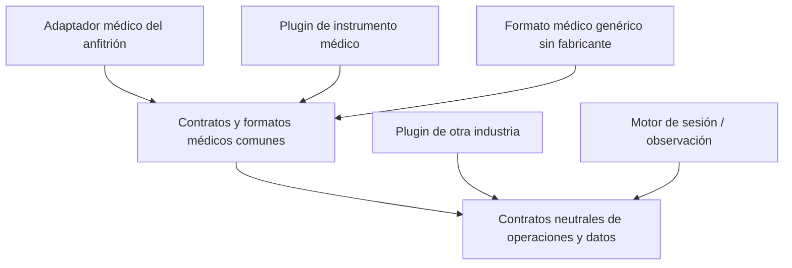

# Operaciones, contratos de datos y especializaciones (#416)

Análisis de diseño, 2026-11-01. [Issue propietario EDC #416](https://github.com/kalyx-ar/EDC/issues/416). Propietario técnico ASTM; EDC es un consumidor. **Propuesta de estructuración, sin implementación nueva ni cambio de paquetes.** La implementación/mejora sigue abierta en el issue.

## Lineamiento humano y problema actual

ASTM general debe ser neutral respecto de industria. La orientación médica sólo se incorpora mediante un plugin de instrumento médico o un formato médico genérico del propio ecosistema ASTM. La operación comprende datos, construcción/interpretación, validación, correlación y lifecycle; no se reduce a un perfil genérico de resultados.

Hoy la neutralidad es principalmente respecto del LIS: `Astm.Abstractions/Model/CanonicalModel.cs`, `Hosting/ILabWorkflowHost.cs` y `Astm.Plugins/PluginContracts.cs` contienen WorkOrder, PatientContext, OrderQuery y observaciones de laboratorio. Los contratos ASTM, HL7 y contenido están separados por protocolo, pero no comparten una descripción suficiente de operación/datos.

`IInstrumentCommandPlugin` expone sample/tests como strings y construye WorkOrder con Patient=null. Los builders por equipo saben generar H/P/O/L o MSH/PID/ORC/OBR, pero no publican todas sus reglas al consumidor. `IInstrumentOperationPolicyProvider` de #414 está implementado sólo por StandardAstmPlugin y el monitor actual se limita a LIS01/LIS02. Esto no acredita flags completos por fabricante.

## Alternativas y recomendación

| Alternativa | Consecuencia | Decisión recomendada |
|---|---|---|
| Tipos y nombres internos EDC como ABI | Simplifica un host y acopla biblioteca/plugins a su negocio y releases. | Mantenerlos en adaptador EDC. |
| Mensajes HL7 v2 como operaciones universales | OML/ORL/OUL/ACK describen formatos concretos; no representan todos los protocolos o industrias. | Usarlos en codecs/perfiles HL7. |
| Recursos FHIR completos como ABI de todo ASTM | Agrega estructura clínica al núcleo y conversiones innecesarias para operaciones locales/industriales. | Ofrecer equivalencias/adaptadores médicos explícitos. |
| Núcleo neutral + contratos médicos comunes + especializaciones de equipo | Un host enlaza una vez la semántica común; el fabricante conserva su protocolo/reglas. | **Adoptar como dirección de diseño.** |

La propuesta toma conceptos reconocibles de HL7/FHIR donde coinciden, sin declarar conformidad FHIR/LAW ni añadir SDK, servidor REST o dependencia externa.

Separar dependencias primero. Nombres de paquetes/namespaces como `Astm.Operations` y `Astm.Formats.Medical` son candidatos, no proyectos ya creados. El motor neutral no referencia Patient, HL7, EDC ni ILabWorkflowHost. Los contratos médicos y sus formatos genéricos sí pueden conocer pacientes/muestras/solicitudes. Los plugins heredan esos contratos y los restringen sin duplicar el modelo común.

## Superficie común de operaciones

Facets conceptuales separados para no exigir a un importador de archivos que implemente control de equipo:

| Facet propuesta | Responsabilidad |
|---|---|
| `IOperationCatalog` | Enumerar operaciones, versiones, datos, roles, capacidades y evidencia por perfil. |
| `IOperationBinding<TInput,TOutput>` | Validar datos y preparar la operación de forma tipada. |
| `IOperationDecoder<TOutput>` | Interpretar bytes/mensajes/contenido entregados por el host. |
| `IOperationSession` | Ejecutar/responder mediante el motor de sesión y el transporte aportado por el host. |
| `IOperationObserver` | Exponer operaciones correlacionadas y snapshot actual sin enviar comandos. |

`OperationDefinition` identifica propósito semántico, tipo Command/Query/Event/Import, versión, esquemas de entrada/salida, rol iniciador/respondedor, perfil, capacidades y alcance de finalización. Construir, interpretar, ejecutar, observar y cancelar son capacidades independientes. Recibir resultados no habilita iniciar análisis, cancelar órdenes o calibrar.

`Prepare` produce un plan/payload validado e inmutable con la revisión del perfil. No envía bytes ni declara éxito del equipo. El motor conserva handshake/encuadre dinámico, plazos y respuestas; el host aporta Stream/bytes y custodia. No convertir toda operación multietapa en un único byte[] fijo. Al cambiar perfil/configuración antes del envío se revalida. El preview no ejecuta acciones ni genera una nueva identidad de negocio en cada reintento.

## Contratos de datos consultables

Cada operación publica `InputContract`/`OutputContract`: ID estable, versión, esquema estructural y tipos CLR registrados. DTOs tipados internamente; representación serializable en el borde para ETL/otros lenguajes. No sustituir el modelo por Dictionary<string,object>, nombres CLR arbitrarios o parámetros sample/tests ilimitados.

Cada campo describe path semántico estable, tipo, cardinalidad, formato/unidad/códigos, límites de caracteres y bytes según encoding, origen del valor y reglas condicionales. Distinguir omitido, null, vacío, no informado y no admitido. Publicar origen: Input, HostContext, Configuration, Generated, Fixed o Derived; también posibilidad de sobreescritura. IDs/códigos viajan con sistema/autoridad, no como GUIDs EDC obligatorios.

Una sola definición debe alimentar metadata, validación estructural y codec tipado para evitar divergencias. Se recomienda un subconjunto declarativo acotado de condiciones (exists, equals, in, and/or), sin scripts ni código descargado del descriptor. El validador del plugin es autoritativo para reglas de equipo y dependencias complejas; devuelve código/path/expectativa sin reproducir valores sensibles. La validación del host no lo sustituye.

Se puede exportar una proyección JSON Schema 2020-12. Esa referencia no exige implementar un validador completo ni incorporar un paquete. Las restricciones específicas no expresables quedan identificadas en el esquema y ejecutadas por el binding; no anunciar que una validación genérica las verificó.

`MessageContext` técnico separa emisor, receptor, control ID, correlación, versión, instante y encoding del contenido de dominio. H/MSH no se transforma en Patient. Un registro P/PID presente tampoco prueba paciente identificado.

Ejemplo conceptual, no requisito confirmado para todos los equipos:

| Path | Regla que el plugin debe poder publicar |
|---|---|
| `message.sender` | Procede de configuración; puede ser fijo y no editable por cada operación. |
| `message.controlId` | Generado por runtime según reglas de correlación/duplicados del protocolo. |
| `order.specimen.identifier` | Requerido para esa operación; sistema de identificación explícito. |
| `order.requestedTests` | Cardinalidad y códigos admitidos del equipo. |
| `patient.identifier` | Requerido sólo bajo la condición documentada para ese perfil/operación; nunca universal. |
| `patient.birthDate` | Opcional/requerido/no admitido según perfil, formato y restricciones explícitos. |
| `specimen.role` | Paciente, control o calibrador en contrato médico; puede cambiar qué datos se admiten. |

Separar **lo que el código actual permite**, **lo que exige el manual** y **lo inferido de una traza**. Por ejemplo, ArchitectDialect.PatientRecord permite Patient ausente y omite sus datos en controles. Esto no demuestra por sí solo que cualquier operación de cualquier ARCHITECT admita paciente ausente. Nunca rellenar datos ficticios para satisfacer un campo ni descartar datos requeridos silenciosamente.

Extensiones de fabricante con namespace, schema y evidencia; conservar el original. Una extensión desconocida que modifique la interpretación debe producir incompatibilidad/revisión explícita. Las extensiones sólo informativas pueden preservarse sin impedir procesar el núcleo médico común.

## Nombres médicos y equivalencias

Reservar la equivalencia [FHIR OperationOutcome](https://hl7.org/fhir/R5/operationoutcome.html) para diagnósticos de una acción, no para su lifecycle. Para el contrato neutral de ejecución usar OperationReceipt y OperationState; el seguimiento conceptual se alinea con Task.

Identificadores propuestos, pendientes de cerrar al implementar:

| Propósito | Datos comunes | Equivalencia conceptual / límite |
|---|---|---|
| `medical.lab.order.submit` | `LaboratoryOrder`, `RequestedTest`, `Specimen`, `PatientContext` condicional | FHIR ServiceRequest para la solicitud; un lote WorkOrder no es necesariamente un único ServiceRequest. |
| `medical.lab.worklist.query` | `WorklistQuery`, `WorklistAnswer` | Consulta y respuesta correlacionadas; distinguir sin información, no disponible y rechazo. |
| `medical.lab.observation.report` | `ObservationBatch`, `Observation` | FHIR Observation para valores atómicos; no equivale a validación clínica EDC. |
| `medical.lab.quality.report` | Material de control/calibrador, estadísticas y referencias | Informa calidad/calibración; no ejecuta calibraciones por esa sola capacidad. |
| `medical.lab.export.import` | Contenido declarado y observaciones/estadísticas | EOF de CSV/RDML termina importación, no certifica fin del proceso físico. |

Patient, Specimen, Observation y Device son nombres reconocibles de HL7/FHIR. `LaboratoryOrder` se prefiere para el agregado local de solicitudes; mapear explícitamente a ServiceRequest cuando corresponda. `DiagnosticReport` se reserva para un informe/grupo con ese significado, no para cualquier bloque/ACK. EDC traduce órdenes, prestaciones/determinaciones, muestras y Resources mediante su adaptador; sus nombres/IDs no pasan a ser el ABI de ASTM.

OML/ORL/OUL/ACK/MSH/PID y H/P/O/R/L permanecen en el binding técnico. El mismo propósito puede usar LIS02, HL7, un protocolo propietario o un formato de contenido, con restricciones y capacidades distintas. Un formato médico genérico también puede proveer estas operaciones sin marca; no exige inventar un instrumento físico para hacer ETL.

## Estado, recibos y uso del canal

Mantener operaciones concurrentes por ID/correlación, propósito, padre/lote opcional y referencias de traza. Separar estado Pending/Running/Completed/Failed/Cancelled/Unknown, evidencia alcanzada y cobertura de observación. Los nombres exactos de la máquina se cierran con el contrato; no reutilizar una lista de estados de negocio EDC como estado del protocolo.

Evidencia diferenciada: transmitido por transporte, mensaje reconocido, orden aceptada/rechazada y ejecución del equipo informada. Un ACK no acredita automáticamente las etapas siguientes. Recepción final de un mensaje o resultado aislado tampoco cierra un workflow multietapa sin la regla del equipo. El significado de recepción, aceptación y proceso se preserva en recibos separados.

Separar **conversación que exige continuidad de canal** de **orden/análisis de larga duración**. El perfil declara qué etapas requieren conservar control y cuáles admiten cederlo. Una orden pendiente durante horas no impone retener un COM si el protocolo permite terminar su conversación; tampoco se supone que sea seguro ceder por estar en silencio. La política de observación del equipo conserva esa decisión y su incertidumbre.

`OperationInProgress` debe expresar su scope; `NoPendingOperations` para cesión evalúa las conversaciones pertinentes al canal con cobertura suficiente. Lista vacía, desconexión o cobertura desconocida no significan libre. La ejecución física puede seguir activa aunque el intercambio haya finalizado. #414 aporta un monitor específico inicial, no el modelo universal de estas operaciones. No introducir permisos nuevos ni escalar automáticamente al hard de PortGate.

## Operativa y coste

Flujo común: descubrir → negociar contrato/perfil → enlazar datos tipados → validar → preparar → transmitir/interpretar con motor → actualizar recibos/estado → materializar en Application del host. Cachear descriptores/codecs por versión y revisión, no reconstruir schema por frame ni usar reflexión dinámica por lectura.

Negociar por separado versión del contrato neutral, contrato semántico, revisión del perfil y versión del protocolo/formato. Una incompatibilidad se detecta antes de enviar. Reintentos conservan identidad de operación de negocio; el plugin define los IDs/reintentos de cable que su protocolo admite. No confundir deduplicación con igualdad de valores: dos mediciones iguales pueden ser legítimas.

Priorizar extraer contratos y reutilizar codecs existentes, después dos pilotos distintos y finalmente el resto. No reescribir todos los protocolos ni crear un servicio remoto obligatorio. Estimación de alcance por fases y adopción ETL/EDC en el documento consumidor `Documentacion/Modulos/LIMS/operaciones-astm-416.md` del checkout EDC.

## Fuentes primarias consultadas

Se usan ediciones publicadas identificadas, no la compilación CI ni una declaración de conformidad:

- [FHIR R5 5.0.0 OperationDefinition](https://hl7.org/fhir/R5/operationdefinition.html): inspiración para descubrir parámetros/tipos/cardinalidades de operaciones; ASTM no adopta su interfaz REST.
- [FHIR R5 ElementDefinition](https://hl7.org/fhir/R5/elementdefinition.html): referencia para restricciones/cardinalidad/bindings de campos.
- [FHIR R5 ServiceRequest](https://hl7.org/fhir/R5/servicerequest.html), [Observation](https://hl7.org/fhir/R5/observation.html), [Specimen](https://hl7.org/fhir/R5/specimen.html) y [DiagnosticReport](https://hl7.org/fhir/R5/diagnosticreport.html): equivalencias semánticas médicas, no identidad completa de modelos.
- [FHIR R5 Task](https://hl7.org/fhir/R5/task.html): referencia conceptual para seguimiento separado de la solicitud.
- [IHE PaLM TF-2b, rev.11.0, Final Text 2024-04-08](https://ihe.net/uploadedFiles/Documents/PaLM/IHE_PaLM_TF_Vol2b.pdf): LAW y distinción de reconocimiento de mensaje, aceptación de orden y avance del trabajo; no acredita conformidad LAW del plugin actual.
- [JSON Schema 2020-12](https://json-schema.org/draft/2020-12): posible formato de exportación del schema; sin dependencia añadida.

Las decisiones de arquitectura son recomendaciones propias a partir del código y estas fuentes. Los manuales de cada fabricante siguen siendo la autoridad de sus campos, timers y operaciones. Esta sesión no usó trazas clínicas privadas ni homologó hardware.
