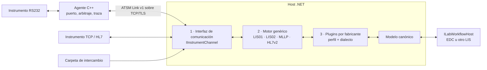

# ATSM: integración de instrumentos de laboratorio

Fecha: 24 de octubre de 2026. Estado: **propuesta en implementación**: núcleo .NET, plugin Architect, herramientas de traza y agente nativo Windows x64 implementados y probados; ver [ESTADO](ESTADO.md).

ATSM es un proyecto **neutral**: un agente de comunicación, un motor genérico de los protocolos de laboratorio (CLSI LIS01-A2 / LIS02-A2, conocidos como ASTM E1381 / E1394, y HL7 v2.5.1 / IHE LAW) y plugins por fabricante. No depende de ningún LIS/LIMS; cada sistema anfitrión implementa un único puerto. El primer anfitrión será EDC ([INTEGRACION-EDC](INTEGRACION-EDC.md)).

El nombre del repositorio se mantiene `ATSM`; en el texto, el protocolo se llama por su nombre normativo.

## Las tres piezas



| Pieza | Documento |
|---|---|
| 1. Interfaz de comunicación: canales, agente nativo, protocolo ATSM Link, TLS, formato de traza | [INTERFAZ-COMUNICACION](INTERFAZ-COMUNICACION.md) |
| 2. Motor genérico: capas baja/mensaje/sesión/flujos, perfiles | [MOTOR-GENERICO](MOTOR-GENERICO.md) |
| 3. Plugins: contrato, nivel declarativo, aislamiento, kit de conformidad, catálogo inicial | [PLUGINS](PLUGINS.md) |
| Modelo canónico y puerto del anfitrión (LAW/FHIR, LOINC/UCUM) | [MODELO-CANONICO](MODELO-CANONICO.md) |

## Documentos de soporte

| Documento | Contenido |
|---|---|
| [ESTANDARES](ESTANDARES.md) | Normas por capa, ediciones aceptadas y evidencia de manuales/trazas |
| [ARQUITECTURA](ARQUITECTURA.md) | Responsabilidades, despliegues, plataformas, TLS, latencia |
| [CONTRATOS](CONTRATOS.md) | Identidades, arbitraje, generaciones, transferencia de control, estados |
| [TRAZAS-Y-RECUPERACION](TRAZAS-Y-RECUPERACION.md) | Niveles de traza, checkpoints, herramientas y recuperación por operación |
| [IMPLEMENTACION](IMPLEMENTACION.md) | Etapas, matriz de aceptación, migración desde Glyms |
| [ESTADO](ESTADO.md) | Qué está implementado, qué se verificó y qué falta |
| [CONTINUACION](CONTINUACION.md) | Pendientes con alcance y criterios de aceptación, para retomar el trabajo |
| [DEPENDENCIAS](DEPENDENCIAS.md) | Dependencias externas: origen, versión, licencia, verificación y aprobación |
| [DATOS-DE-PRUEBA](DATOS-DE-PRUEBA.md) | Corpus, privacidad, anonimización, manuales |
| [INTEGRACION-EDC](INTEGRACION-EDC.md) | Cómo lo consume EDC (cuatro capas, ETL, Identidades, distribución) |
| [REFERENCIAS-GLYMS](REFERENCIAS-GLYMS.md) · [referencias-glyms.json](referencias-glyms.json) | Ensamblados legacy en producción, código decompilado y hashes (material local) |
| [CONTEXTO-PARA-EDC](CONTEXTO-PARA-EDC.md) | Texto para transferir a la sesión que implemente en EDC |
| [ejemplos/](ejemplos/README.md) | Configuración sintética de agente e instrumento |

## Decisiones tomadas

1. **Agente C++17 nativo** para RS232 ↔ TCP, con TLS configurable por endpoint y arbitraje exclusivo por instrumento. Plataformas: Windows XP/7/8/10/11, Linux x64/ARM (Raspberry) y ESP32, cada una con build y verificación propios. Sin UDP.
2. **Motor y plugins en C# (`net10.0`)**, alojables en servidor o en cliente local.
3. **El motor recibe un canal binario con eventos**, el mismo para túnel serial, TCP nativo, serial local, mensajes completos aportados por el anfitrión y reproducción de trazas.
4. **El agente no interpreta el protocolo**; el motor implementa el estándar; el plugin sólo el dialecto; el anfitrión decide el negocio.
5. **Recuperación por operación**, con evidencia de traza; no hay política universal de cancelar o reenviar.
6. **Datos reales fuera del repositorio**; el corpus publicado es anonimizado.

## Propuestas nuevas de esta revisión

- Protocolo **ATSM Link v1**: cabecera binaria fija + control en CBOR determinista + bytes crudos; esquemas CDDL y vectores compartidos.
- **Mbed TLS 4.1 LTS** (4.1.1) como backend TLS del agente, aprobado; registro en [DEPENDENCIAS](DEPENDENCIAS.md).
- **HL7 v2.5.1 / IHE LAW** como segundo protocolo del motor; el manual HL7 del ARCHITECT ya está disponible.
- **Modelo canónico** alineado con LAW y proyectable a FHIR, con doble codificación (fabricante + LOINC/UCUM vía LIVD).
- **Host query sincrónico con plazo** y **resultados durables idempotentes**: dos caminos distintos hacia el anfitrión.
- Mensajes completos del anfitrión (P-01 resuelto, sin gestión de archivos en ATSM) y canal `Replay`; **importadores** de logs de Glyms y Sysmex al formato de traza ATSM.
- **Kit de conformidad por plugin** ejecutado con `dotnet test` sobre corpus anonimizado.

## Estructura propuesta del repositorio

```text
ATSM/
  README.md  LICENSE  SECURITY.md  CHANGELOG.md
  spec/                  link-v1.cddl, agent-config.schema.json, profile.schema.json, model-v1, trace-v1
  native/                agente C++17 (core, platform/win32|posix|esp32, tls, tools) — CMake
  dotnet/
    src/                 Atsm.Abstractions, Atsm.Channels, Atsm.Protocol.*, Atsm.Runtime, Atsm.Fhir, Atsm.Testing
    plugins/             Atsm.Plugin.Abbott.Architect, Atsm.Plugin.Abbott.CellDynRuby, Atsm.Plugin.Sysmex.Uwam, …
    tools/               atsm-trace (importar, anonimizar, ver, comparar), atsm-sim (simulador de instrumento)
    tests/
  conformance/           vectores de Link v1 y corpus anonimizado compartido
  Documentacion/         esta carpeta
```

## Orden de trabajo sugerido

1. `spec/` + `Atsm.Abstractions` + `Atsm.Testing` (canal simulado, reloj virtual).
2. `Atsm.Protocol.Lis01` y `Lis02` con casos E01–E05 sintéticos.
3. `atsm-trace import/anonymize` sobre las trazas Architect → primer corpus.
4. Plugin Architect sobre `Replay` y `LocalSerial`; luego Ruby y U-WAM.
5. Agente nativo (Windows x64 → XP → Linux → ESP32) y canal `SerialTunnel`.
6. Arbitraje y failover; HL7/LAW.

En paralelo, en EDC: Issue de decisión y adaptador `ILabWorkflowHost` contra el canal `Replay`.

## Pendiente de decidir

- Licencia: decidido, libre uso. Firma: Strong Name con la SNK de EDC y Authenticode en el release (ver [ESTADO](ESTADO.md#decisiones-registradas)).
- Publicación de paquetes NuGet de ATSM para EDC (Mbed TLS ya aprobado).
- DeltaLab por archivo: resuelto por decisión humana, conector EDC/ETL, fuera del motor instrumental.
- Primer instrumento para pruebas de banco y acceso a un equipo de prueba.

## Alcance de esta entrega

La propuesta inicial era sólo documental; lo implementado y comprobado desde entonces está en [ESTADO](ESTADO.md). No se conectaron equipos reales. [verificacion-propuesta.json](verificacion-propuesta.json) registra la comprobación documental de la entrega anterior.

La ampliación [Mensajes, trazas y HL7](MENSAJES-TRAZAS-HL7.md) registra P-01 resuelto, HL7/MLLP y ARCHITECT implementados, LAW parcial y la custodia de trazas por la aplicación orquestante. En EDC se exige SQLCipher preparado antes de comunicar y diagnóstico autorizado por UI; su composición sigue pendiente.
