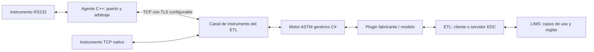

# Propuesta para EDC / LIMS / ATSM

Fecha: 24 de octubre de 2026. Estado: propuesta de arquitectura y contratos para implementar en el repositorio EDC. Se conserva `ATSM` en la ruta solicitada; el nombre del protocolo en los documentos es **ASTM**.

## Decisión de partida

Construir un agente **C++ nativo** que conecte RS232 con **TCP**, con **TLS configurable por endpoint** y arbitraje de acceso por instrumento. El ETL, ejecutado en un cliente EDC o en el servidor EDC, utilizará un motor ASTM genérico en **C#** y plugins por fabricante/modelo. También se admitirán instrumentos con TCP nativo a través del mismo contrato de canal.

**UDP queda excluido de esta propuesta.** El transporte conserva bytes y eventos técnicos. La interpretación del protocolo, las operaciones y la recuperación de sesiones corresponden al motor ASTM, al plugin y al proceso de negocio.

## Guía de lectura

| Documento | Para qué sirve |
|---|---|
| [ARQUITECTURA.md](ARQUITECTURA.md) | Responsabilidades, cuatro capas, plataformas, TLS y despliegue |
| [CONTRATOS.md](CONTRATOS.md) | Canal común, arbitraje, permisos de control, eventos y contrato agente–ETL |
| [TRAZAS-Y-RECUPERACION.md](TRAZAS-Y-RECUPERACION.md) | Herramientas transversales, trazas, checkpoints y escenarios de recuperación |
| [IMPLEMENTACION.md](IMPLEMENTACION.md) | Etapas de trabajo, pruebas de aceptación y decisiones por instrumento |
| [REFERENCIAS-GLYMS.md](REFERENCIAS-GLYMS.md) | Rutas absolutas a ensamblados originales, código decompilado y evidencia de negocio |
| [CONTEXTO-PARA-EDC.md](CONTEXTO-PARA-EDC.md) | Texto listo para transferir a la sesión que implemente en EDC |
| [ejemplos/agente.json](ejemplos/agente.json) | Configuración ilustrativa del puente y sus límites |
| [ejemplos/instrumento.json](ejemplos/instrumento.json) | Selección del transporte, plugin y perfil en el ETL |
| [referencias-glyms.json](referencias-glyms.json) | Mapa legible por herramientas, con rutas y hashes de los binarios |

## Requisitos acordados

1. La librería ASTM recibe un stream binario bidireccional y eventos de estado; conserva independencia de COM, IP y TLS.
2. El agente administra bytes, puerto, control de flujo y propiedad exclusiva. El plugin adapta ASTM a las particularidades reales del instrumento.
3. Puede haber múltiples candidatos conectados, con un único controlador activo por instrumento y cola de solicitudes de control.
4. El cambio de controlador puede ser entre servidores o hacia un cliente local con capacidad de resolver ASTM.
5. Las herramientas comunes registran y permiten entender la traza. La decisión de recuperación se toma por operación, protocolo y proceso; no hay una política universal de cancelación o reenvío.
6. Las plataformas objetivo son Windows XP/7/8/10/11, Linux, Raspberry y ESP. El primer perfil de microcontrolador propuesto es ESP32; otros modelos requieren su propia comprobación.
7. C++ permite reducir overhead y compartir el núcleo; el rendimiento y la compatibilidad deben comprobarse en los builds y dispositivos concretos.

## Base de conocimiento de Glyms

**Según lo informado por el usuario, los desarrollos de Glyms aquí referenciados están en uso productivo.** Contienen lógica legacy y código de baja calidad, pero aportan evidencia de procesos y particularidades que deben investigarse al migrar. La calidad del código no invalida su valor como referencia de comportamiento.

La propuesta distingue decisiones nuevas, comportamiento visible en el código y confirmaciones pendientes con equipos/usuarios. Una rama de código recuperada no demuestra por sí sola que se ejecute en todas las instalaciones. Las anomalías conocidas requieren una decisión explícita de conservar, corregir o retirar.

Las rutas y hashes están en [REFERENCIAS-GLYMS](REFERENCIAS-GLYMS.md). Se trabaja con C# decompilado, no con el proyecto fuente original. En `Plugin_Architect/PlugIn.cs` existe una diferencia previa respecto del hash de extracción: se conserva como está y se mantiene la referencia al ensamblado original para contrastar.

## Alcance de esta entrega

Se entrega documentación portable, contratos propuestos, ejemplos de configuración y referencias verificables. El repositorio EDC no está en este workspace: los nombres de proyectos y carpetas son una correspondencia para adaptar a sus cuatro capas. No se compiló un agente, no se conectaron equipos y no se ejecutaron pruebas operativas.

Para trasladar la propuesta, copiar esta carpeta a `EDC/LIMS/ATSM` o a la ubicación documental equivalente. Los enlaces internos del paquete son relativos. Las referencias a Glyms incluyen rutas absolutas del workspace actual y un manifiesto con rutas relativas al directorio Glyms, para poder resolverlas en otra máquina.

## Control de la entrega

[verificacion-propuesta.json](verificacion-propuesta.json) registra enlaces/rutas comprobados, lectura de JSON, consistencia de los ejemplos y hashes de las referencias. La diferencia previa del C# de Architect se identifica como advertencia conocida. Este control no acredita compilación, soporte de plataformas ni ejecución de protocolos o de negocio.
